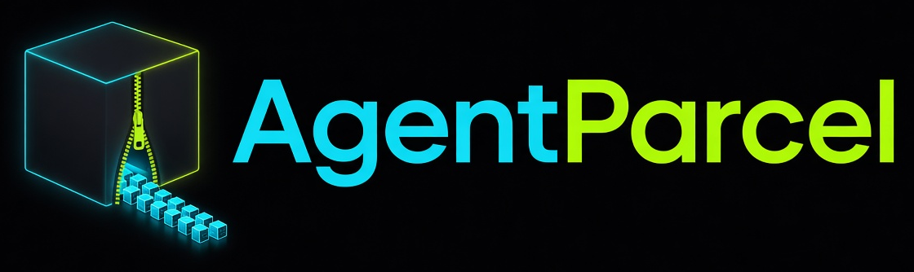
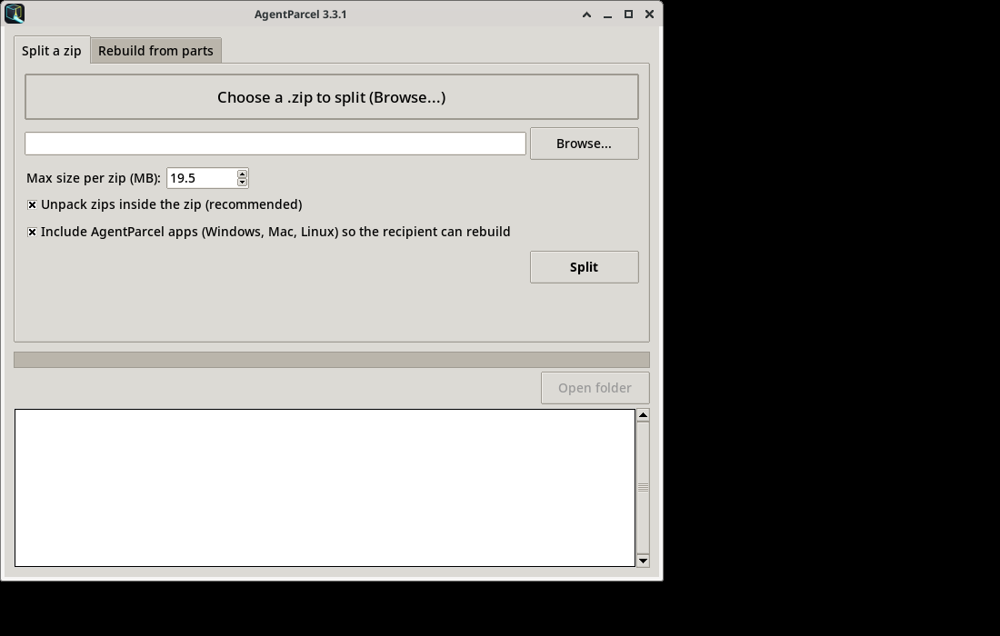

<p align="center">
  <picture>
    <source media="(prefers-color-scheme: dark)" srcset="src/assets/agentparcel-wordmark.png">
    
  </picture>
</p>

<p align="center">
  Split a large file into parts an AI agent will accept, then rebuild it with SHA-256 checks.<br>
  <a href="https://agentparcel.net">agentparcel.net</a>
  &nbsp;·&nbsp;
  <a href="https://github.com/MASTER246C/agentparcel/releases">Downloads</a>
  &nbsp;·&nbsp;
  <a href="https://chriskalkowski.com">chriskalkowski.com</a>
</p>

**AgentParcel** lets AI agents hand off large files to other agents and cloud agents that enforce strict per-file upload limits. It splits a zip or a folder into size-capped zip parts, or byte-splits any single file (PDF, video, dataset, CAD, and so on) into numbered raw parts, stores a SHA-256, and rebuilds the original on the other side. Parts made on Windows, macOS, and Linux rebuild on any of the three.

It ships three ways:

- **Apps** for Windows, macOS, and Linux: a window, plus a command line.
- A **stdio MCP server** (Python standard library only, plus optional `cryptography` when parts are encrypted) with tools `inspect`, `split_zip`, `split_any_file`, `split_files`, `verify`, `regenerate_parts`, `rebuild`, and `make_apps_bundle`.
- A **rebuild kit**. With "Include AgentParcel apps" left on, the split folder also gets `AgentParcel-apps.zip`: the Windows, Mac, and Linux programs, a short "how to rebuild" note, and the license. Send it with the parts so the receiving machine has the program.

The default cap is **19.5 MiB** per part (19.5 × 1024 × 1024 = 20,447,232 bytes). When an upload limit is quoted in decimal megabytes — a "20 MB" cap that means 20,000,000 bytes — use 19 MB, or pass an exact `max_bytes`. Zip parts are ordinary zips and open on their own. A byte-split part is a raw slice of the original file. Rebuild checks SHA-256, and it names any missing or corrupt part before it writes anything.

**3.5.0** adds presets, re-send of missing parts, optional zlib and AES-256-GCM, and a pip-installable package. 3.3.x and 3.4.0 part sets still verify and rebuild. With compression and encryption left off, a byte split is the same raw parts as 3.4.0.

- **Size presets** pick the part cap: `chatgpt-dot` (19,000,000 bytes, under a 20,000,000 byte ChatGPT Dot cap), `chat-512` (500,000,000 under 512,000,000; products differ), `discord` (24,000,000 under the free 25 MB cap; Nitro is higher and is not this preset), `email` (24,000,000 under a common 25 MB mailbox cap), `github-release` (1,900,000,000 under GitHub's 2 GB per-file release limit), and `custom` (default 19.5 MiB). Each cap sits under the advertised limit. Those limits can change; confirm the current one before a large send.
- **Re-send missing parts.** Verify names what is missing or corrupt. Resend in the window, or the MCP tool `regenerate_parts`, rewrites only those parts from the original file. Parts that already match are left untouched. Rebuild says which parts are still needed.
- **Optional compression and encryption**, both off by default. Zlib (one part at a time) is undone by `rebuild.py` with the Python standard library. Password encryption is AES-256-GCM with scrypt, from the `cryptography` package (`pip install agentparcel[crypto]`). The manifest records the algorithm, salt, and per-part nonce. It never records the password. `rebuild.py` cannot decrypt an encrypted set and does not write a file; use AgentParcel and give the same password.
- **Install with pip** (not uploaded in this release): `pip install agentparcel` provides `agentparcel` and `agentparcel-mcp`.

3.4.0, still in this release: split any file, verify, `HOW-TO-REBUILD.txt` plus `rebuild.py`, and Stop (Cancelled, and the partial output from that run is removed).

<p align="center">
  
</p>

## Why it exists

> I made AgentParcel with Grok Bot because ChatGPT Dot has a 20 MB file limit, other chats have a 512 MB limit, and so on. This is how I hand a large file to another agent, or to a cloud agent, when the chat will not take the whole thing.
>
> — Chris Kalkowski

During development the working name was ZipSplitter. AgentParcel is an independent project. It is not affiliated with, endorsed by, or derived from any other project named ZipSplitter, and it does not use any of that project's code. See [About the name](#about-the-name).

## Downloads

Get the tested packages from the [Releases](https://github.com/MASTER246C/agentparcel/releases) page. Current release: **[AgentParcel 3.5.0](https://github.com/MASTER246C/agentparcel/releases/tag/v3.5.0)**.

| Package | Platform |
|---|---|
| [AgentParcel-3.5.0-windows.zip](https://github.com/MASTER246C/agentparcel/releases/download/v3.5.0/AgentParcel-3.5.0-windows.zip) | Windows 10/11. The app is PowerShell 5.1, which Windows already includes. Python is only for the MCP server. |
| [AgentParcel-3.5.0-linux.zip](https://github.com/MASTER246C/agentparcel/releases/download/v3.5.0/AgentParcel-3.5.0-linux.zip) | Linux with Python 3.9+ (3.15 recommended). The window needs Tk; without it the app runs in text mode. |
| [AgentParcel-3.5.0-macos.zip](https://github.com/MASTER246C/agentparcel/releases/download/v3.5.0/AgentParcel-3.5.0-macos.zip) | macOS 11+ with Python 3.9+. **Community-tested/beta.** Mac users: if you hit an issue or can help test, reach out via chriskalkowski.com. |
| [SHA256SUMS.txt](https://github.com/MASTER246C/agentparcel/releases/download/v3.5.0/SHA256SUMS.txt) | Checksums for the three zips. |

```text
5d5f2f8e2c686fb55a8a1c22eaf3552c5f8569c3300aed4d5b69560d51df4aa8  AgentParcel-3.5.0-windows.zip
1b4945d991ebe66e98e259c3f947b77e93feb3b451b2dbb41db64fd67a81f114  AgentParcel-3.5.0-linux.zip
4555029a839d203194e1d5ba3b8ac21aa5f0b170dd06e2ef77b121377af81ff8  AgentParcel-3.5.0-macos.zip
```

Check a download with `sha256sum -c SHA256SUMS.txt` (Linux), `shasum -a 256 -c SHA256SUMS.txt` (macOS), or `Get-FileHash .\AgentParcel-3.5.0-windows.zip` (Windows PowerShell).

## Quick start

Extract the zip first. Do not run the app from inside the archive.

### Windows

1. Double-click `AgentParcel.bat`.
2. **Split**: choose a `.zip`, set the size limit, and click Split. Parts go to `<name>_split\`. Leave "Include AgentParcel apps" ticked when the receiver needs the program. For any other file, or with "Byte-split this file", the parts are raw slices of that file (`<filename>_split\`).
3. **Verify**, then **Rebuild**. Verify names missing and corrupt parts and writes nothing. Rebuild puts the original back.
4. **Stop** cancels the job and reports Cancelled.

If Windows shows "Windows protected your PC", click **More info**, then **Run anyway**. These are plain text scripts.

```bat
powershell -ExecutionPolicy Bypass -File AgentParcel.ps1 -NoGui -LimitMB 19.5 "C:\path\big.zip"
powershell -ExecutionPolicy Bypass -File AgentParcel.ps1 -NoGui -SplitBytes "C:\path\movie.mp4"
powershell -ExecutionPolicy Bypass -File AgentParcel.ps1 -Verify "C:\path\big_split"
powershell -ExecutionPolicy Bypass -File AgentParcel.ps1 -Join "C:\path\big_split" -OutputDir "C:\out"
```

You can also drag a zip or a part onto `AgentParcel.bat`. For the MCP server, double-click `Install-Python-for-AgentParcel.bat`. It installs Python 3.15 for your user (no admin), smoke-tests the server, and writes `MCP-config-snippets.txt` with your real paths. It does not edit agent configs.

### Linux

```sh
unzip AgentParcel-3.5.0-linux.zip && cd AgentParcel-3.5.0-linux
./install-deps.sh          # python3 and Tk, via apt/dnf/yum/pacman/zypper; it asks before sudo
./agentparcel.sh           # opens the window
```

If a script is not executable (it was copied through Windows, for example): `chmod +x *.sh *.py mcp/*.py`.

```sh
python3 agentparcel.py --no-gui --limit-mb 19.5 /path/big.zip
python3 agentparcel.py --join /path/big_split --output-dir /tmp/out
```

`agentparcel.desktop` is an optional menu entry. Edit its `Exec=` path, then copy it to `~/.local/share/applications/`.

### macOS

**Community-tested/beta.** It is the same Python program as the Linux release. Finder, Gatekeeper, the Tk window, and `install-python-macos.sh` still need a pass on Mac hardware. Mac users: if you hit an issue or can help test, reach out via chriskalkowski.com. `TESTING-CHECKLIST.md` inside the zip is the list to work through.

1. Double-click the zip in Finder and move the folder somewhere such as Documents.
2. In Terminal:

```sh
cd ~/Documents/AgentParcel-3.5.0-macos
xattr -dr com.apple.quarantine .     # optional: skips the "unidentified developer" prompts
./install-python-macos.sh --check    # or without --check, to install Python 3.15
```

3. Double-click `AgentParcel.command`. The first time, macOS may block it: right-click, **Open**, then **Open**. If it says permission denied: `chmod +x AgentParcel.command agentparcel.py mcp/*.py`.

Use Python from python.org (`/usr/local/bin/python3`) or Homebrew (`/opt/homebrew/bin/python3` on Apple silicon). Apple's `/usr/bin/python3` stub is the wrong one, and its Tk can look broken.

```sh
python3 agentparcel.py --no-gui --limit-mb 19.5 ~/Downloads/big.zip
python3 agentparcel.py --join ~/Downloads/big_split --output-dir ~/Desktop
```

## MCP server

`mcp/agentparcel_mcp.py` speaks [Model Context Protocol](https://modelcontextprotocol.io) over stdio. It needs Python 3.9 or newer (3.15 recommended; 3.11 or newer for archives over 4 GB) and the `agentparcel.py` engine in the same folder. No extra packages.

| Tool | What it does |
|---|---|
| `inspect` | Read-only. Sizes, entry count, estimated parts. For a part: set id, part n of N, and which parts are missing. |
| `split_zip` | Split a `.zip` into `<name>_part01.zip`, `_part02.zip`, … each at most `max_mb` or a `preset`. |
| `split_any_file` | Byte-split any one file. Optional `compress` (zlib) and `password` (AES-256-GCM). |
| `split_files` | Zip files and folders, then split them, in one step. |
| `verify` | Read-only. Names missing and corrupt parts. |
| `regenerate_parts` | Rewrite only the missing or corrupt parts from the original file. |
| `rebuild` | Rebuild the original from a folder, one part, or a list of parts. SHA-256 checked. Says which parts are still needed. `extract=true` also unpacks a zip. |
| `make_apps_bundle` | Write `AgentParcel-apps.zip` for a person on the other side. |

Paths must be absolute. The server never overwrites or deletes a file; a name that is taken gets ` (2)`. An agent receives the apps bundle only when it passes `include_apps=true`.

Optional sandbox: set `AGENTPARCEL_MCP_ROOTS` to the folders the server may read and write (`;` on Windows, `:` on Mac and Linux). `ZIPSPLITTER_MCP_ROOTS` is still accepted when `AGENTPARCEL_MCP_ROOTS` is unset. That fallback comes from our own development builds, not from any other project named ZipSplitter. See [About the name](#about-the-name). Remove `env` from a snippet to allow every path.

Big splits can take minutes. Codex CLI's `tool_timeout_sec` defaults to 60; the snippet below sets 1800. For Claude Code, set `MCP_TOOL_TIMEOUT=1800000` (milliseconds) before starting it.

Each release zip has `mcp/README-mcp.txt` with snippets filled in for that platform. Replace `YOU` with your home folder, and on Windows prefer the full path of a real `python.exe` (not the Microsoft Store shortcut). `Install-Python-for-AgentParcel.bat` writes those paths for you.

**Cursor** — `~/.cursor/mcp.json`, or `<project>/.cursor/mcp.json`. On Windows the file is `%USERPROFILE%\.cursor\mcp.json`.

```json
{
  "mcpServers": {
    "agentparcel": {
      "command": "/usr/bin/python3",
      "args": ["/home/YOU/AgentParcel-3.5.0-linux/mcp/agentparcel_mcp.py"],
      "env": { "AGENTPARCEL_MCP_ROOTS": "/home/YOU" }
    }
  }
}
```

Once the package is on PyPI, an MCP client can start it without a checkout. `uvx` runs the script named `agentparcel-mcp` from the `agentparcel` package. Encryption needs the `crypto` extra.

```json
{
  "mcpServers": {
    "agentparcel": {
      "command": "uvx",
      "args": ["--from", "agentparcel", "agentparcel-mcp"]
    }
  }
}
```

`pipx run agentparcel-mcp` is the same idea after `pipx install agentparcel`. `pip install agentparcel` puts `agentparcel` and `agentparcel-mcp` on `PATH`. `pip install "agentparcel[crypto]"` adds AES-256-GCM. This release is packaged and tested locally. It has not been uploaded. To publish, build the sdist and wheel (`python -m build`) and upload them with twine and a PyPI API token (`python -m twine upload dist/agentparcel-*.tar.gz dist/agentparcel-*.whl`). Do not commit the token.

macOS uses `/usr/local/bin/python3` (python.org) or `/opt/homebrew/bin/python3` (Homebrew), and a path under `/Users/YOU/AgentParcel-3.5.0-macos/mcp/`. Windows uses the Python 3.15 `python.exe` and a path such as `C:\\Users\\YOU\\AgentParcel-3.5.0-windows\\mcp\\agentparcel_mcp.py`.

**Claude Desktop** — merge the same `mcpServers` object into the config, then restart the app.

- Windows: `%APPDATA%\Claude\claude_desktop_config.json`
- macOS: `~/Library/Application Support/Claude/claude_desktop_config.json`
- Linux: there is no official Claude Desktop build. Use Claude Code, Cursor, or Codex CLI.

**Claude Code** (once, for every project):

```sh
claude mcp add agentparcel --scope user --env AGENTPARCEL_MCP_ROOTS="$HOME" -- \
  /usr/bin/python3 "$HOME/AgentParcel-3.5.0-linux/mcp/agentparcel_mcp.py"
```

**Codex CLI** — `~/.codex/config.toml` (on Windows, `%USERPROFILE%\.codex\config.toml`):

```toml
[mcp_servers.agentparcel]
command = "/usr/bin/python3"
args = ["/home/YOU/AgentParcel-3.5.0-linux/mcp/agentparcel_mcp.py"]
env = { AGENTPARCEL_MCP_ROOTS = "/home/YOU" }
startup_timeout_sec = 20
tool_timeout_sec = 1800
```

Try the server by hand:

```sh
python3 mcp/agentparcel_mcp.py --version
python3 mcp/agentparcel_mcp.py --list-tools
```

## About the name

ZipSplitter was our internal working name during development. Before release we researched it, found another existing project already using that name, and switched to AgentParcel for the public release.

AgentParcel is an independent project. It is not affiliated with, endorsed by, or derived from any other project named ZipSplitter, and it does not use any of that project's code. ZipSplitter was only our internal working name; all AgentParcel code was written from scratch for this project.

Leftover `_zipsplitter_*` marker files and `ZIPSPLITTER_*` environment-variable fallbacks come from our own development builds, not from that other project. They remain only for backward compatibility. The markers (`_zipsplitter_part.json`, `_zipsplitter_manifest.json`, `_zipsplitter_apps.json`) stay in each part set, and `ZIPSPLITTER_MCP_ROOTS` / `ZIPSPLITTER_PY` still apply when the matching `AGENTPARCEL_*` variable is unset. Parts from those builds still rebuild, and those builds still rebuild AgentParcel parts. A development apps bundle is named `ZipSplitter-apps.zip`; AgentParcel ignores it, and those older builds ignore `AgentParcel-apps.zip`.

Point an agent config at `agentparcel_mcp.py`. The server name in the snippets is `agentparcel`.

## From this repository

| Path | What it is |
|---|---|
| `src/` | The programs: `AgentParcel.core.ps1`, `agentparcel.core.py`, `agentparcel_mcp.py`, launchers, and the docs `build.py` packs into each release. |
| `src/assets/` | Neon icon (PNG, `.ico`, `.icns`) and wordmark. |
| `src/release/` | Per-platform READMEs, install helpers, license, changelog, and release notes. `@@ZS_VERSION@@` is filled in at build time. |
| `build.py` | Builds the three platform packages into `dist/` (gitignored). |
| `make_assets.py` | Regenerates `src/assets/` from the neon source images. |
| `tk-window-agentparcel-icon.png` | Screenshot of the window. |
| `LICENSE.txt` | AgentParcel License 1.0. |
| `CHANGELOG.md` | History. Entries before 3.3.1 use the internal working name. |

```sh
python3 build.py
```

`dist/` is a local build. The zips attached to the GitHub Release are the tested packages; a fresh run of `build.py` is not byte-for-byte identical, because the packager stamps the current time. History is in [CHANGELOG.md](CHANGELOG.md).

## License

AgentParcel License 1.0 ([LICENSE.txt](LICENSE.txt)). Copyright (c) 2026 Chris Kalkowski.

This is **source-available**. It is not OSI-approved open source, because of the Equal Tier Availability rule.

In plain English:

- You may use, copy, modify, share, and sell it, including commercially. Keep the license and the copyright notice with it.
- You may market it as an included feature. Charging for your own product is fine.
- If a product with several plans or tiers includes AgentParcel, every tier that can use that kind of tool must get it on equal terms, free tier included. For the MCP server that means every tier with MCP or tool access. For the apps, every tier that can run local apps or scripts. It cannot be reserved for a higher or paid tier. Usage limits on it cannot be stricter than the limits on comparable tools in that same tier.
- A tier with no such access at all does not have to get it, as long as that gap is general and is not a way to single out AgentParcel.
- There is no warranty.

Licensing questions and other permissions: [chriskalkowski.com](https://chriskalkowski.com).

## Contact

- Project site: [https://agentparcel.net](https://agentparcel.net)
- Chris Kalkowski: [https://chriskalkowski.com](https://chriskalkowski.com)
